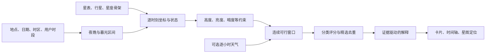

“今晚看什么”实现计划

调研日期：2026-10-27。首版实现更新：2026-10-28。本文保留完整设计和后续扩展，当前已实现 `/tonight` 的晴空裸眼推荐、观测地时区与时段、连续窗口、推荐理由、高度曲线和星图定位。实现范围与验证见 `frontend/src/features/tonight/README.md`；天气、中国星官、器材模型与观测记录仍属后续阶段。

建议把功能定义为：给定观测地点、当地日期和可用时段，挑出少量值得看的目标，说明什么时候看、朝哪里看、为什么推荐，并能直接在现有星图中找到它。天文位置、环境条件和用户偏好分别计算，最后组合推荐。

1. **已经找到的相关产品与资料，可以分别借鉴什么。**

| 来源 | 官方资料能够确认的能力 | 对本项目的启发 |
| --- | --- | --- |
| Stellarium 的 AstroCalc / What's Up Tonight | 按当前日期、地点、目标类别列出夜间可见目标；支持前半夜、后半夜、午夜附近和整夜等时段 | 建立可核对的目标筛选与观测时段计算 |
| 天文通中国官网 | 明确介绍“今晚看什么”，包括未来 15 个夜晚的目标高度、云量与观测窗口，并提供任意时地天空模拟 | 把目标高度曲线、天气变化和推荐窗口放在一起 |
| Astronomy Engine | 支持浏览器端日月行星位置及事件计算；项目已使用 2.1.19 | 继续复用当前计算库和坐标约定 |
| astroplan | 提供按高度、暮光、月距等约束判断可观测性的模型 | 借鉴其约束组合思路，首版无需引入 Python 服务 |

产品依据：[Stellarium 官方用户指南](https://stellarium.org/guide/)、[天文通官网](https://twtapp.com/)。技术依据：[Astronomy Engine](https://github.com/cosinekitty/astronomy)、[astroplan 约束示例](https://astroplan.readthedocs.io/en/latest/tutorials/constraints.html)。

天文通公开资料可以证实功能存在，不能据此推断其内部评分权重，或声称它已经提供本方案设想的逐条解释。以下评分、阈值和交互是本项目设计建议，不是对竞品算法的复刻。

2. **当前项目已经具备主要计算和内容基础。**

| 现有基础 | 本次复用方式 | 需要补足 |
| --- | --- | --- |
| `astronomy-engine@2.1.19` | 日月行星位置、月相、星等、距离 | 暮光、时间窗、整夜采样 |
| 8870 颗恒星的物理星表 | 恒星坐标、Johnson V 星等、自行与物理 ID | 从完整星表筛选推荐候选，不让全部星进入推荐列表 |
| 西方 88 星座连线与边界、中国传统文化包、夏季和冬季大三角 | 星座骨架、名称、星群成员 | 关键骨架星、入门难度、找星步骤等推荐元数据 |
| `SkyFrameCalculator` 与模块 Worker | 保持推荐结果与实时星图一致 | 提取不依赖渲染、不提前过滤的坐标采样接口 |
| 现有目标搜索和星图聚焦 | 推荐卡片点击定位 | 带时刻、地点、文化和目标 ID 的跳转协议 |
| 星空记忆课程、天体百科 | “认识它”“练习这个星座”入口 | 可靠的目标 ID 到课程/百科映射 |

核查入口：[前端依赖](F:/code/astro/frontend/package.json)、[坐标计算](F:/code/astro/frontend/src/features/sky-map/coordinates.ts)、[星图 Worker](F:/code/astro/frontend/src/features/sky-map/skyMap.worker.ts)、[物理星表清单](F:/code/astro/backend/services/astronomy-service/src/main/resources/catalogs/naked-eye/manifest.json)、[文化包清单](F:/code/astro/backend/services/astronomy-service/src/main/resources/catalogs/sky-content/manifest.json)。

两项现状需要特别处理：现有星图输出会按高度等条件过滤，不能拿“当前帧看得见的目标”作为整晚候选全集；现有 `datetime-local` 按浏览器本地时区解释，规划其他地区的夜晚时需要独立的观测地时区。

3. **首版用户流程和功能范围。**

建议新增 `/tonight`，从首页与实时星图提供入口。用户先选地点、日期和时段，默认裸眼模式，首页先给 3–5 个精选目标，其余在分类列表中展开。

输入包括：经纬度、海拔、IANA 时区、当地日期、可用时段。地点支持已有城市预设、手动坐标和用户点击触发的定位；未经选择的城市必须标为示例地点。补充“城市 / 郊区 / 暗空 / 不确定”环境选项，用于保守调整辨认难度，不能冒充实测光污染。

时段提供“现在起一小时”“前半夜”“后半夜”“整夜”和自定义。前半夜按日落到当地午夜，后半夜按午夜到日出；用户有明确起止时间时始终以其选择为准。天文暗度另行计算，不要求所有目标等到天文暮光结束才出现。

页面按用户决策顺序显示：地点和时间 → 今晚概览 → 精选目标 → 整晚时间轴 → 分类列表。概览分别说明天黑时段、月亮情况和天气数据状态。首版未接天气时，明确显示“以下按晴空、无遮挡条件估算”。

每张卡片至少有：名称与类型、推荐时段、该时段的方向和高度、肉眼/器材要求、两条推荐理由、一条主要限制、在星图中查看。支持“现在看”“稍后更好”“需要赶早”等状态，但“赶早”必须指向具体阈值，例如何时降至 15°以下，不能把它写成真正落下时间。

示例文案模板（占位符来自计算结果，不是某个实际夜晚的预报）：

> 木星：建议 {start}–{end} 观察，{bestTime} 位于{direction}，高度约 {altitude}°。这段时间位置较高，亮度适合裸眼寻找；如使用望远镜，可以进一步观察细节。{constraint}

> 猎户座：建议 {start}–{end} 辨认，关键骨架星中 {visible}/{total} 颗达到所选条件。先找{anchorPattern}，再沿星图确认其他成员。{faintStarCaveat}

首版实现四类目标、规则解释和星图联动。天气增强、观测记录、少量天象和学习偏好逐步加入。深空摄影、卫星过境、全套设备建模和自动日程提醒不作为本次首版依赖。

4. **先算可行时段，再比较推荐程度。**



时间统一保存为 UTC 瞬间；当地日期和显示使用选定地点的 IANA 时区，不能把经度换算当作民用时区。跨午夜显示“次日”，夏令时重复或缺失的本地时间必须明确解析。浏览器时区改变不应改变相同观测请求的结果。日期范围沿用当前恒星模型的 1800–2200 年限制，远期日期只能提供天文几何规划，不能假装具备天气预报。

用所选当地日期的“中午到次日中午”识别一次夜晚，在其中定位日落、日出与暮光事件。“现在”处于午夜后且日出前时，应保留正在进行的夜晚；已过去的窗口不进入“现在起”的推荐。极昼、极夜或没有天文黑夜时，保留真实状态，根据用户时段和太阳高度计算，不虚构日落时间。

天文计算约定：太阳暮光使用几何中心高度 −6°、−12°、−18°；日月升落与目标达到推荐高度是不同事件。官方定义见 [USNO 升落与暮光说明](https://aa.usno.navy.mil/faq/RST_defs)。

实现上复用 `Equator`、`Horizon`、`Rotation_EQJ_HOR`、`Illumination`；用 `MoonPhase` 区分盈亏，用 `SearchAltitude` 求暮光，用 `SearchRiseSet` 求升落。太阳系位置保持站心计算；恒星延续现有 ICRS、自行与旋转管线。`SearchAltitude` 不计折射及天体半径，不能替代日月升落；无事件返回空值而不是 00:00。观测站海拔和观察者离地高度也应分别建模。具体签名以[当前 2.1.19 官方 API](https://github.com/cosinekitty/astronomy/blob/v2.1.19/source/js/README.md)和已安装类型为准。

建议先以 5 分钟步长采样候选目标，计算高度、方位、太阳高度、月亮高度、亮度及必要的月距；同一时刻复用观测者、太阳月亮状态和坐标旋转。对约束切换处细化到约 1 分钟。对于擦过高度阈值的情况，增加极值/中天检查及自适应采样，避免两个采样点都不合格而漏掉中间短窗口。

将满足约束的连续区间合并，再按可用时长筛选。主推荐默认需要至少 20 分钟连续窗口；短窗口仍可列在“挑战目标”中。这是产品初始参数，可调而非天文学标准。多个窗口应分别保留，尤其未来接入云量之后不能把中间的坏天气连成连续好时段。

最佳时刻从“用户时段 ∩ 目标可行窗口”中选择。最高高度时刻、上中天时刻和综合最佳时刻分别存储：天体中天可能在白天、在用户睡觉后，或恰逢云量较高。界面优先给一个有宽度的推荐时段，避免制造“只有 21:37 才适合”的错觉。

5. **四类目标分别判断，不能共用一套简单星等排序。**

| 类型 | 首版候选与硬条件 | 主要加分依据 | 解释与限制 |
| --- | --- | --- | --- |
| 月球 | 当晚有合适高度和时段；新月附近不保证可见 | 高度、持续时间、月相与所选观测目的 | 裸眼赏月相/月海，器材看地形；接近满月不应宣称陨坑阴影最突出 |
| 行星 | 裸眼优先水金火木土，逐个计算当晚位置 | 高度、实际亮度、窗口长度、容易寻找 | 水金允许单独的暮光策略；天王星、海王星默认不放入入门裸眼精选 |
| 亮星 | 从现有星表筛亮星，首批人工审核约 40–60 颗 | 亮度、高度、找星锚点价值、识别特色 | 城市环境更保守；不能用季节标签代替位置计算 |
| 星座/星群 | 使用主要骨架星与关键连线，而非一个中心坐标 | 骨架完整程度、最弱关键星的辨认难度、形状清晰度 | “主要图形适合辨认”不等于整个 IAU 天区都在地平线上 |

可先将主推荐高度设为 ≥20°、≥30°给予更高评价；15°–20°作为条件一般，低于 15°明显提示。水星等暮光目标采用独立策略，可以适当降低门槛，但不能只因星等亮就视为容易看到。所有数值是待实地校准的产品默认值。

暮光门槛按目标类型和亮度设置：月球、明亮行星可在较亮天空中观察；亮星和主要星座通常需要更暗的背景。首版可用太阳高度 −6°、−12°作为不同类别的保守筛选档位，再用连续评分调整；它们不是对所有星等均成立的人眼可见性公式。对于水星、近太阳的新月等，首版宁可降为挑战或不推荐，不能把一个固定日距角当成可见性的充分条件。

月球同时扮演“观测目标”和“影响其他目标的背景光源”。月光影响至少结合月相、月亮是否在地平线上、月亮高度、目标与月亮夹角、目标本身亮度；月亮已经落下时不应仅因接近满月就处罚整晚亮星。月光对月球本身不减分，对明亮行星影响较小，对暗骨架星的辨认影响更大。首版使用定性等级，避免伪造精确天空亮度或肉眼发现概率。

月球推荐内容应与器材匹配。上弦附近明暗交界线的阴影有利于观察地形，这有明确的 [NASA 观月资料](https://science.nasa.gov/moon/observe-the-moon-night/overview/)支持；满月仍有赏月和明暗区域辨认价值。月相比例不足以确定具体某个陨坑是否处于最佳光照，月面地标推荐需另加月面太阳位置与天平动计算，放到后续阶段。

星座需新增 `keyStarIds`、`requiredAnchorIds`、`corePaths`、`recognitionDifficulty`、`findingSteps` 等内容元数据。每个采样时刻对骨架星计算高度和估计可辨认性，要求关键锚点满足条件，再按加权可见比例判断，例如先试 80%。关键星必须满足条件，不能由大量边缘星的高分抵消；未审核的星座只提供几何状态，不自动宣称容易辨认。

首批可审核 15–20 个常见星座/星群，计算结构支持扩展现有 88 星座。长蛇等跨度大的星座按主要识别部分给推荐。夏季大三角应标“星群”，中国传统星官保持独立文化 ID。[IAU 对星座与图形的说明](https://www.iau.org/IAU/IAU/Astronomy-FAQs/Constellations.aspx)说明正式星座按天区边界定义，因此产品文案需准确区分这些概念。

6. **评分可解释，推荐结果保持多样。**

硬条件先排除不适合的目标，例如可行窗口为空、器材不匹配、关键骨架缺失。推荐分只在合格候选中排序，不能靠知名度抵消在地平线以下这样的失败。

建议初版使用下面的规则结构，各特征归一化到 0–1，按目标类型配置权重：

`基础分 = 100 ×（高度质量 × wH + 易辨认程度 × wV + 窗口长度 × wD + 观赏/学习价值 × wI）− 已知条件惩罚`

| 类别 | 高度质量 | 易辨认程度 | 窗口长度 | 观赏/学习价值 |
| --- | ---: | ---: | ---: | ---: |
| 月球 | 30% | 10% | 20% | 40% |
| 行星 | 35% | 30% | 20% | 15% |
| 亮星 | 30% | 40% | 15% | 15% |
| 星座/星群 | 25% | 40% | 20% | 15% |

这是调参起点，未经实测校准。高度质量在较高仰角后逐渐饱和；易辨认程度对月球侧重相位和寻找难度，对点目标考虑亮度与天空背景，对星座考虑关键骨架完整度和暗星。窗口内用持续表现和时长评价，避免只取一个瞬间峰值。月光、暗度若已计入易辨认程度，不再重复扣分。

精选区先为合格类别保留展示机会，再按分数、可用时间和内容重复度挑选。月球或行星不合适时允许该类为空；同一片天区的一颗亮星、一个星座和一个大三角不应占满所有名额。临近窗口结束可以影响“先看哪个”的顺序，但不应把困难目标包装成最容易的目标。

用户界面优先展示“优先推荐 / 值得看看 / 条件有限”，内部保留分数、分项和策略版本。不要把推荐分写成“看见概率 92%”。未知天气单独显示，不按晴天满分填补。

解释由规则直接产生，首版不依赖大模型。每个推荐输出结构化 `reasonCodes` 和对应事实：例如 `HIGH_ALTITUDE` 引用时刻与高度，`LONG_WINDOW` 引用连续分钟数，`PATTERN_COMPLETE` 引用关键星计数，`MOONLIGHT_LIMITATION` 引用月亮高度和角距。主卡选两条最有区分度的理由与一条主要限制，展开后再显示完整依据。

同一事实必须带时间锚点，避免文案说“现在在东南”，而数字显示的是两小时后的最高点。推荐中的“较少受低空影响”只能描述几何优势；天气未知时不能生成“空气通透、视宁度很好”。未来若使用大模型润色，只允许改写已计算事实，新增数值和天象判断仍由确定性逻辑负责。

7. **在现有工程中按以下结构接入。**

建议新增模块根目录 `frontend/src/features/tonight/`，新增页面 `frontend/src/views/TonightView.vue`，保持推荐核心是可单测的纯 TypeScript。下表均为拟新增或拟修改位置。

| 模块/文件 | 职责 |
| --- | --- |
| `tonight/types.ts` | 请求、目标、窗口、证据、降级状态与版本 |
| `tonight/nightWindow.ts` | 观测地时区、夜晚归属、暮光与用户时段求交 |
| `tonight/candidates.ts` | 从物理星表、文化包和人工内容选择候选 |
| `tonight/ephemerisSampler.ts` | 多时刻采样；复用共享坐标基础 |
| `tonight/visibility.ts` | 约束、连续窗口、特殊状态 |
| `tonight/constellationVisibility.ts` | 骨架星和连线的可辨认性 |
| `tonight/ranking.ts` | 分类评分、去重与精选分配 |
| `tonight/reasons.ts` | 规则代码和事实绑定 |
| `tonight/observingTargets.ts` | 入门内容、关键星、器材提示及来源 |
| `tonight/components/` | 推荐卡片、时间轴、条件表单 |
| 现有 `sky-map/coordinates.ts` | 提取共享无过滤采样内核，保留原星图计算接口兼容 |
| 现有 Worker、`workerClient.ts`、`types.ts` | 增加独立 `plan-tonight` 请求与响应 |
| 现有 `SkyMapView.vue` 与路由 | 接收地点、UTC 时刻、文化和目标定位参数 |

扩展现有 Worker 可以复用已加载星表，但不能让整夜同步循环堵住当前星图计算。按时间批次计算，批次之间让出事件循环，并用请求代次取消过期结果；仅在最后丢弃旧响应不足以解决 CPU 阻塞。若基准测试仍影响星图响应，再增加专用 Worker，复用同一纯计算核心与版本化资源。

示意契约如下，实施时完善各目标类型的判别联合与字段约束：

```ts
interface TonightRequest {
  observer: { latitudeDeg: number; longitudeDeg: number; elevationMeters: number }
  timeZone: string
  nightDate: string
  interval: { startUtc: string; endUtc: string }
  equipment: 'naked-eye' | 'binoculars' | 'telescope'
  environment: 'urban' | 'suburban' | 'dark' | 'unknown'
  cultureId: string
  interfaceLanguage: string
}

interface Recommendation {
  targetId: string
  targetType: 'moon' | 'planet' | 'star' | 'constellation' | 'asterism'
  windows: Array<{ startUtc: string; endUtc: string }>
  recommendedWindow: { startUtc: string; endUtc: string }
  bestAtUtc: string
  positionAtBest: { altitudeDeg: number; azimuthDeg: number }
  score: number
  scoreBreakdown: Record<string, number>
  reasons: Array<{ code: string; atUtc?: string; facts: Record<string, number | string> }>
  limitations: string[]
  weatherStatus: 'not-requested' | 'available' | 'partial' | 'unavailable' | 'stale'
}
```

整份结果另外记录计算时间、当前请求代次、天文库版本、星表/文化包/推荐内容版本和评分版本；完整候选诊断保存被排除原因，供测试和“为什么没推荐月亮”查询。无可行窗口时不构造一个带虚假最佳时刻的 `Recommendation`。

星图联动建议编码观测者、`at`（UTC）、`culture`、`targetType`、`targetId`，在参数校验、文化包加载和对应时刻帧计算完成后再聚焦。恒星沿用 HIP 物理 ID，行星沿用现有稳定 ID，星座沿用文化包 ID。初版用推荐时刻打开星图；若用户选“现在位置”，应重新计算并允许提示已不适合。

MVP 延续现有后端的星表与内容资源分发，不增加一个重复计算星历的 Java 服务。只有接天气、服务端收藏或跨设备同步时再新增对应接口。课程推荐放在可选内容层，个性化排序不能改变天文可行性。

缓存分两层：天文采样按坐标、海拔、UTC 区间、折射选项和数据版本缓存；推荐结果再按器材、环境、文化、策略版本和天气更新时间缓存。不同精度的坐标不能在未说明误差的情况下混用。数据预先加载后可本地重算，但“完整离线打开网页”仍需额外资源缓存工作。

8. **天气作为第二阶段增强，数据缺失时仍能完成规划。**

先接一个 provider，保留替换接口。可试用 Open-Meteo 的逐小时总云量、分层云量、降水、湿度和风等字段，字段覆盖以选定模型为准；请求跨度必须覆盖跨午夜窗口。[Open-Meteo 预报文档](https://open-meteo.com/en/docs)列出了可选变量。

将预报按 UTC 时间匹配目标窗口，找出“天体位置好且预报较合适”的连续区间。云量只是区域预报，不等于某个方向的遮挡概率，也不能直接用 `100 − 云量` 宣称成功率。地面风速或湿度不能单独代表望远镜所需的视宁度。

天气失败、过期、部分缺失或日期超出预报范围时，保留天文推荐并明确状态。对于高云量等不利条件，可显示“若云隙出现可尝试”，不能仍展示无条件的“今晚极佳”。提供预报来源、有效时段和更新时间。

如使用商业 API 或需要缓存限流，通过现有后端增加天气聚合接口，按网格与预报时次缓存，不把密钥放在前端。Open-Meteo 数据许可与托管 API 使用套餐要分别处理，当前免费 API 不覆盖商业使用，部署时核对[官方套餐说明](https://open-meteo.com/en/pricing)。

光污染首版使用用户环境档位；后续地图数据需保留分辨率、年代与来源。室外灯光、树木和楼宇仍需用户判断。可进一步支持按方位设置地平遮挡曲线，判定条件为目标高度超过该方向遮挡高度及余量。

9. **验证要同时覆盖天文正确性和推荐是否有用。**

| 验证内容 | 必须覆盖的场景与通过条件 |
| --- | --- |
| 独立天文基准 | 日月行星对照 JPL Horizons；同地点、同 UTC、同站心与折射设置；恒星另用独立资料/工具核对 |
| 时间与地点 | 深圳、北京、赤道、南半球、高纬；跨午夜、夏令时切换、浏览器与观测地时区不同 |
| 天体边界 | 月亮不升/不落、日落不存在、无天文黑夜、目标擦过阈值、中天不在用户窗口 |
| 推荐逻辑 | 不推荐地平线下目标；满月夜仍可推荐合适月球/行星；月落后解除月光影响；短窗口不会被夸大 |
| 星座 | 中心在地平线上但关键骨架未升起；关键暗星难辨；跨赤经零点、南天和跨度大星座 |
| 解释 | 每个数值来自事实字段；时间锚点一致；缺少天气时不能生成好天气理由 |
| 集成 | 卡片点击后星图的目标、时刻和地点一致；快速改城市不会显示旧城市结果 |
| 性能与降级 | 中档手机热缓存初次规划争取 1 秒内完成；冷加载单独计时；天气失败和星表失败分别呈现 |

日月行星可使用 [JPL Horizons 官方服务与说明](https://ssd.jpl.nasa.gov/horizons/manual.html)生成固定参考样本，避免只拿同一个库的结果互相验证。初始验收可设高度大于 15°的方向角距误差目标不超过 0.1°，在匹配定义、普通纬度和理想地平条件下暮光事件误差目标约 2 分钟；这是拟定验收指标，需要实际样本验证，不承诺近地平真实升落精度。接近天顶时比较球面角距，避免方位角数值不稳定。

自动化测试使用 Vitest 覆盖纯逻辑和组件，随后运行现有星图/学习回归与生产构建。人工用 Stellarium 在固定时地抽查推荐列表与高度曲线，并做若干城市/郊区实地观察，调整默认阈值。首批内容重点核对“能找到”与“能看到细节”的区别。

上线前须明确验收：四类目标均能出现合理候选；不合适时能解释为何为空；每个精选目标有真实窗口、方向和原因；天气未知可用；更换地点日期稳定重算；点击进入星图位置一致。

10. **按可交付成果分阶段实施。**

| 阶段 | 主要工作 | 交付与退出条件 | 粗略工作量 |
| --- | --- | --- | --- |
| A：统一计算基础 | 观测地时间模型、共享无过滤坐标内核、暮光与窗口 | 固定测试时地得到正确夜晚和连续窗口，现有星图不回归 | 2–3 人日 |
| B：推荐核心 | 四类候选、骨架元数据、评分、解释、独立基准 | 可运行纯函数产出可核验推荐，包含空结果和边界状态 | 4–5 人日 |
| C：可用页面 | 表单、精选卡片、分类列表、时间轴、星图和百科/课程链接 | 手机可完成“选地点→选目标→找目标”，联动一致 | 3–4 人日 |
| D：验收与校准 | 跨时区/高纬测试、性能、实测内容校准 | 达到上述首版验收条件 | 2–3 人日 |
| E：环境增强 | 天气 provider、缓存、状态与窗口融合 | 天气不可用不阻断规划，解释有来源与时效 | 另计 3–5 人日 |

按一位熟悉当前仓库的开发者估算，A–D 约 11–15 人日，约 2–3 周；包含首批内容审核，不含大规模素材制作、复杂地图、生产天气套餐采购和完整设备能力建模。实际排期应在 A 阶段基准与数据审核后调整。

后续优先级建议依次为：观测记录和本地偏好、与星空记忆结合、少量可独立计算和验证的伴月/近距离天象、中国星官推荐、器材观察能力、月面具体地标。天象的发生时间和当地可见窗口必须分开计算。

新增内容继续保留来源与版本。当前工程已有不同许可的星表、名称和文化数据，沿用[第三方声明](F:/code/astro/THIRD_PARTY_NOTICES.md)，不要把全部资料统一标为 MIT。Stellarium 可用于功能参考和结果交叉检查；新增推荐规则独立实现。
